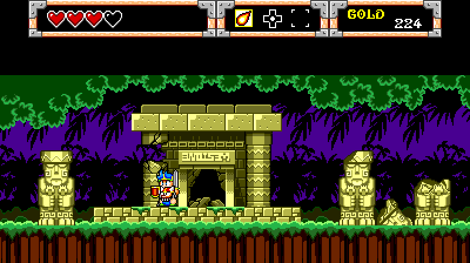
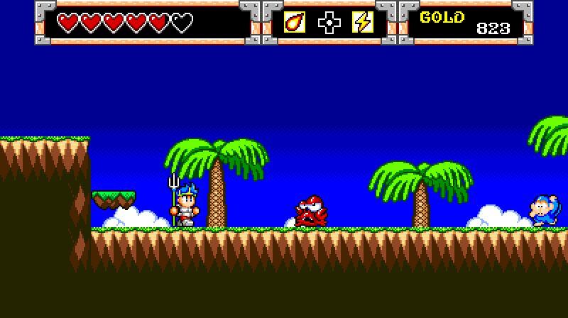
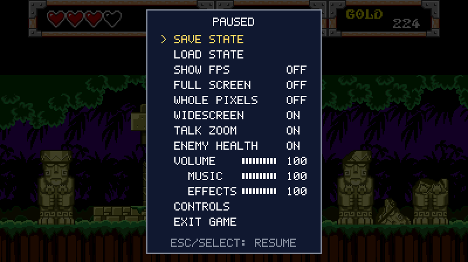

# Wonder Boy in Monster World (Genesis/Mega Drive) — C port

A port of the Sega Genesis/Mega Drive game *Wonder Boy in Monster World* to C. It runs natively
with SDL2. The game's 68000 program is not emulated: every routine was rewritten in C, then
checked against the original in a reference harness (shadow runs, fuzzing, coverage). The game
is playable from start to finish.

Sound too: on the Genesis/Mega Drive, the music and sound effects are played by a small program on
the console's second CPU, a Z80. The port has that driver rewritten in C as well
(`port/sounddrv.c`, checked against the original tick for tick), and it drives emulated sound
chips (ymfm for the YM2612, plus the SN76489). `--z80-sound` plays the original driver on an
emulated Z80 instead.

## Screenshots

**Widescreen** (right), next to the original picture (left):



**Damage numbers and enemy health bars:**



**The menu** (Esc, or Back/Select on a controller):



## Added features

On top of the original game. They are all on by default; each can be turned off in the menu
(Esc), and the setting is kept.

* **Pause menu** (Esc, or Back/Select on a controller) with a confirmation before exiting.
* **Custom controls**: set a key and a controller button, stick direction or trigger for each game
  button, and for quick save and quick load.
* **Settings saved** between sessions (`wbmw.ini`): full screen, whole-pixel scaling, widescreen,
  talk zoom, enemy health, the volumes, frame rate display, controls.
* **Volume**: the overall volume, and the music and the sound effects each on their own, from the
  menu.
* **Four save slots** of the whole game state, each with a picture of the moment it was saved,
  chosen from the menu (**Save state**, **Load state**), plus quick save and load on the current
  slot. Saving over a slot shows its picture and asks first; so does quick load (F4).
* **Full screen** by default, with window mode and whole-pixel scaling.
* **Frame rate display.**
* **Enemy health bars and damage numbers**: when you hit an enemy, the damage rises from it as a
  number (gold for the blow that defeats it), and a small bar over it shows the health it has
  left for two seconds: green, then yellow below two thirds, red below one third. Bosses have
  them too. They stay under the text boxes and the status bar. See `docs/ENEMYHEALTH.md`.
* **Talk zoom (experimental)**: during a conversation with an ordinary character (not bosses),
  the view eases in on Wonder Boy and the one he is talking to over about a second, with the
  text box kept at its own size. It stays zoomed through a conversation that ends with a fade to
  black, such as the inn's. See `docs/TALKZOOM.md`.
* **Widescreen (experimental)**: a 16:9 picture. See `docs/WIDESCREEN.md`.
  * **Most rooms fill it**: 119 of the 170, those whose maps are wide enough. One-screen rooms
    keep the original picture with black sides, unless their sides are painted (in Tiled:
    `docs/MODDING.md`, "Widescreen sides"); then they fill it too, and you can walk into the sides. Houses and shops open over the room outside, as
    in the original, so they stay wide. Rooms switch between wide and narrow only while the
    screen is black during a transition.
  * **A one-row status bar**: hearts, items and gold side by side across the top, in every room.
    The enemy health box is left out, since hits show each enemy's health. The item menu (Start)
    and messages such as "PAUSE" open below it with their own top edge.
  * **Gold as a number**: gold you pick up rises from you as a gold number, in the same style as
    the damage numbers, instead of a "Found ... GOLD" box.
  * **Above the play field**: below and beside the status bar, the scenery shows where the
    room's map reaches that high, each layer as far up as its own map goes. Above that, rooms
    with an open sky or sea show its colour (41 rooms); caves, walls and the rest show black, so
    nothing looks cut off. Wonder Boy and enemies stay visible there; what the original hides
    behind the status bar stays hidden.

## No ROM data is in this repository

**You need your own dump of the cartridge.** This repository contains only source code, tools and
notes. It contains no ROM, no graphics, maps, text, music or sound, and no file made from the ROM,
except the three screenshots above (`docs/images/`, made with `tools/gif.py` from the native build's
frames):

* `rom/` (where you put your dump), `work/` (everything built from it) and `assets/` (the data
  `tools/extract.py` writes out of it) are listed in `.gitignore`. So are save files (`*.sav`)
  and save states (`*.state`).
* The build reads all of the game's data (graphics, maps, text, music, sound, and the sound
  driver's tables) out of your ROM into `assets/` and packs it into `assets/game.pak`, which the game plays
  from; without the pack, the game reads your ROM file directly. The C code holds only the game's
  logic, with a few small numeric tables (jump targets, lookup tables) as part of that logic.

The port expects this dump (the common "USA, Europe" release):

* **File name:** `Wonder Boy in Monster World (USA, Europe).md`
* **Size:** 786,432 bytes (768 KB), no header
* **SHA-1:** `87a968f773c7e807e647c0737132457b06b78276`

A `.bin` with the same contents works too; rename it, or give its path when you run the game. The
extractor and the game read data from fixed places in the ROM, so other versions (Japanese, Wii
Virtual Console repacks, hacks) will not work properly. Both warn you if your file's SHA-1 doesn't
match.

## Play it (Windows)

1. **Install MSYS2** from <https://www.msys2.org> (the default location, `C:\msys64`, is fine).
2. **Open the "MSYS2 UCRT64" shell** from the Start menu and install the compiler, make, SDL2,
   Python and git:

   ```bash
   pacman -S --needed mingw-w64-ucrt-x86_64-gcc mingw-w64-ucrt-x86_64-SDL2 mingw-w64-ucrt-x86_64-python make git
   ```

3. **Get the code:**

   ```bash
   git clone https://github.com/matthewkris/wbmw-decomp.git
   cd wbmw-decomp
   ```

4. **Add your ROM.** Make a folder called `rom` in the repository and put your dump in it, named
   exactly `Wonder Boy in Monster World (USA, Europe).md`:

   ```
   wbmw-decomp/
     rom/
       Wonder Boy in Monster World (USA, Europe).md
   ```

   You can do this in Windows Explorer. In the MSYS2 shell, your C: drive is at `/c/`, so
   `cp "/c/Users/<you>/Downloads/your-dump.md" "rom/Wonder Boy in Monster World (USA, Europe).md"`
   works too.

5. **Build** (takes about a minute):

   ```bash
   make -C native
   ```

   That is in the MSYS2 UCRT64 shell. From PowerShell instead, in the repository's folder, put
   MSYS2's tools on the path first (for that window only):

   ```powershell
   $env:PATH = "C:\msys64\ucrt64\bin;C:\msys64\usr\bin;" + $env:PATH; make -C native
   ```

   This makes `work/native/wbmw.exe` and copies `SDL2.dll` next to it. Then it reads the game's
   data out of your ROM into `assets/` and packs it into `assets/game.pak` (about 15 seconds, the
   first time only), which the game plays from. Without Python it skips this, and the game reads
   the ROM itself instead.

6. **Play:**

   ```bash
   work/native/wbmw.exe
   ```

   You can also double-click `wbmw.exe` in `work\native\`. The game starts **full screen**. It
   plays from `assets/game.pak` (in the repository, in an `assets` folder next to `wbmw.exe`, or
   next to `wbmw.exe` itself). Without one it reads the ROM: from the repository's `rom/` folder,
   a `rom/` folder next to `wbmw.exe`, or next to `wbmw.exe` itself. To use a ROM somewhere else,
   give its path: `work/native/wbmw.exe path/to/rom.md` (a ROM named this way is always used).

To play on another Windows PC, copy `wbmw.exe`, `SDL2.dll` and `assets/game.pak` (in an `assets`
folder next to them, or beside them); the ROM isn't needed once the pack is made. MSYS2 isn't
needed to run the game.

### Controls

These are the defaults. You can change all of them in the menu (**Esc → Controls**).

| Genesis/Mega Drive | Keyboard | Controller |
|---|---|---|
| D-pad | Arrow keys | D-pad (and the left stick) |
| A / B / C | Z / X / C | Left / bottom / right face button (X / A / B on an Xbox pad) |
| Start | Enter | Start |
| *Quick save / load* | F2 / F4 | *not set* |

Controller buttons are named by position, because each make of pad labels them differently
(the Switch's A is where the Xbox's B is).

| Key | Does |
|---|---|
| Esc (controller: Back/Select) | Opens the menu. The game pauses while it's open |
| F11 or Alt+Enter | Switches between full screen and a window |
| F3 | Shows or hides the frame rate |

Back/Select is View on Xbox, Share/Create on PlayStation and Minus on Switch. It opens the menu,
so Start stays the game's own: it opens the item screen.

### The menu

* **Save state**, **Load state**: the four slots, two by two, each with its picture, its number
  and when it was saved. Arrows choose one, Enter saves or loads. Saving over a used slot shows
  its picture with "Overwrite slot N?" (No / Yes). The slot you choose becomes the current one,
  which quick save and quick load use.
* **Show FPS, Full screen, Whole pixels** (every pixel the same size), **Widescreen**, **Talk
  zoom**, **Enemy health** (the health bars and damage numbers): on or off. Widescreen is
  experimental: see **Added features** above.
* **Volume**, **Music**, **Effects**: from 0 to 100 in tens (left and right, or Enter to step up);
  Volume at 0 is the sound off.
  The music and the effects are kept apart even though they share the same sound chips: an effect
  that takes a voice from the music plays at the effects' volume.
* **Controls**: a key and a controller input for each button, plus quick save and quick load.
  Choose one and press Enter (A on a controller), then press the new key or button; on the
  controller side, a stick direction or a trigger works too. A key already used elsewhere swaps
  places with the old one. Delete (Y on a controller) clears one. **Left stick as D-pad** lets
  the stick move you too (turn it off if your stick drifts, or to use its directions for
  something else), and **Reset to defaults** puts everything back.
* **Exit game** asks first.

The menu itself always works with the arrow keys, Enter and Esc, and on a controller with the
D-pad, A and B, whatever you set the game's controls to.

Your settings are saved in `wbmw.ini` next to `wbmw.exe`. Command-line options override them for
one run without changing the file. Delete the file to go back to the defaults.

The slots are files in the current folder: slot 1 is `wbmw.state`, the others `wbmw-2.state`,
`wbmw-3.state` and `wbmw-4.state`, each with its picture beside it (`wbmw.png`, `wbmw-2.png`, ...).
Quick save stores the game in the current slot and quick load returns to it. If the slot is
already used, the first press shows "SLOT N: PRESS SAVE AGAIN TO OVERWRITE"; press it again within
two seconds to replace it. Quick load asks first: the slot's picture with "Load slot N?" (No /
Yes, No selected). A message at the bottom of the screen confirms each one ("SAVED TO
SLOT 2"). The game's own save,
kept on the cartridge's EEPROM, is written to `wbmw.sav` in the current folder when you exit.
Use `--save FILE` for a different file.

### Options

```
wbmw [ROM] [--pack FILE] [--windowed] [--widescreen] [--talk-zoom] [--enemy-health] [--scale N] [--integer-scale] [--fps] [--mute] [--save FILE] [--state FILE] [--load] [--config FILE] [--z80-sound]
```

* `ROM`: play from this ROM instead of `assets/game.pak`. `--pack FILE`: play from this pack.

* `--windowed`: start in a window instead of full screen. `--scale N` sets the window's size, N
  times 256×224.
* `--integer-scale`: scale only by whole numbers, so every pixel is the same size.
* `--no-widescreen`, `--no-talk-zoom`, `--no-enemy-health`: turn that feature off for this run
  (`--widescreen`, `--talk-zoom` and `--enemy-health` turn it on).
* `--fps`: show the frame rate from the start. `--mute`: no sound. `--volume N`,
  `--music-volume N`, `--effects-volume N`: the volumes for this run (0-100). `--z80-sound`: the
  game's original sound driver on an emulated Z80, in place of the C driver.
* `--state FILE`: slot 1's file (the other slots go beside it). `--load`: load slot 1 at start.
* `--config FILE`: use this settings file instead of `wbmw.ini`.

`native/README.md` has the rest, including headless runs and frame logs for testing.

## Linux and macOS

These aren't tested yet, but the build is plain C/C++ with SDL2 and should work. Install a C/C++
compiler, make, Python 3 and the SDL2 development package (Debian/Ubuntu: `sudo apt install
build-essential python3 libsdl2-dev`; macOS with Homebrew: `brew install sdl2 python`). Then follow steps 3 to 6, running
`work/native/wbmw` instead of `wbmw.exe`.

## Troubleshooting

* **"No ROM found"**: the file must be in `rom/` and named exactly as above, including the
  spaces, the brackets and the `.md` extension. Windows may hide extensions, so check the file
  isn't called `....md.md` or `....bin`. Or give the ROM's path on the command line.
* **"... is N bytes; the game's ROM is 786,432 bytes"**: the file isn't a plain dump. It may still
  be zipped, or it may have a 512-byte copier header (`.smd` files are in a different format).
* **"warning: ... is not the expected dump"**: this is a different version or a modified ROM. The
  game may start, but it won't play correctly.
* **"makepack: no Python 3 found"** while building: install it in the MSYS2 UCRT64 shell
  (`pacman -S mingw-w64-ucrt-x86_64-python`) and build again. The game still works without it, by
  reading the ROM.
* **"wbmw: the game read N bytes the files do not hold"** when the game exits: something the game
  needs is missing from `assets/game.pak`. Please report it, with a save state from just before.
  `work/native/wbmw.exe "rom/Wonder Boy in Monster World (USA, Europe).md"` plays from the ROM
  meanwhile.
* **`sdl2-config: command not found`** or **`gcc: command not found`** while building: you are in
  the wrong MSYS2 shell. Use "MSYS2 UCRT64", not "MSYS2 MSYS", and run the `pacman` line from step 2.

## For developers

How the port was made, and how to check it against the original:

* `port/`: the C of every routine in the game. `native/`: the machine core
  (`machine.c`) and the SDL host (`wbmw.c`).
* `harness/`: the reference harness. It runs the original 68000 code (Musashi) with the C routines
  checked against it (shadow mode) or used in its place (replace mode). See `harness/README.md`.
* `tools/`: the disassembler, code/data mapper and test tools (`tools/sndaccept.py` checks the
  sound driver in C against the original; `tools/gif.py` turns frames into GIFs). These also need Python 3 with
  `capstone` (`pip install capstone`); `tools/fixpoint.sh "rom/Wonder Boy in Monster World (USA,
  Europe).md"` writes the code/data map to `work/`. Running `make` at the repository root rebuilds
  the ROM from generated assembly (it needs vasm's `vasmm68k_mot`) and checks that it's
  byte-identical.
* `tools/extract.py "rom/Wonder Boy in Monster World (USA, Europe).md"` writes the game's data out
  of your ROM into `assets/` (graphics, palettes, every room's map, all the text, the sprites and
  their animations, the tables in the code, the music and sound effects; git-ignored, as the ROM
  is), as images, JSON and text that
  can be looked at and changed (and the music as MIDI files, `assets/sound/midi`, to play or edit in
  any music program: `tools/midi.py`). `tools/rebuild.py` checks the files are complete by building the
  ROM's bytes back from them, and `tools/pack.py` packs them into `assets/game.pak`, which the game
  plays from. `tools/makepack.sh`, which the build runs, extracts and packs when needed; files
  changed by hand in `assets/` are packed, not overwritten. See `docs/EXTRACT.md`.
* **Modding:** change the files in `assets/` and build again; the game plays with your changes.
  `docs/MODDING.md` says what can be changed so far, with examples (all the text at any length,
  the rooms' maps in the Tiled map editor (bigger too, and the widescreen sides and the rows above
  a one-screen room painted; `tools/tiled.py export --only areaNN_roomNN` starts a room over), enemies and things in the rooms, monsters' health and damage and the prices by name, the graphics
  as pictures in their real colours, palettes, maps, music) and the safety checks.
* Documentation: `docs/NOTES.md` (what the game does), `docs/PORT.md` (the port and how each routine
  is verified), `docs/PROCESS.md` (the process as a whole), `docs/EXTRACT.md` (the extracted data
  and the pack), `docs/SOUND.md` (the sound driver, its rewrite in C and the music's format), `native/README.md` (the native build), the added features (`docs/WIDESCREEN.md`,
  `docs/TALKZOOM.md`, `docs/ENEMYHEALTH.md`) and `docs/IDEAS.md` (what was asked for, done and to
  do).

## Licence

This repository's own code and documentation are under the MIT licence (see `LICENSE`).
Third-party code is in `third_party/`, each part under its own licence: Musashi (68000, harness
only, with its SoftFloat; MIT), ymfm (YM2612 sound; BSD 3-clause) and the Z80 core from `chips`
(zlib).

This is an unofficial fan project, not affiliated with or endorsed by Sega or the game's other
rights holders. *Wonder Boy in Monster World*, Sega, Genesis and Mega Drive are their owners'
trademarks. The licence does not cover the game itself: none of its data is in this repository,
and you need your own copy of the game to play.
